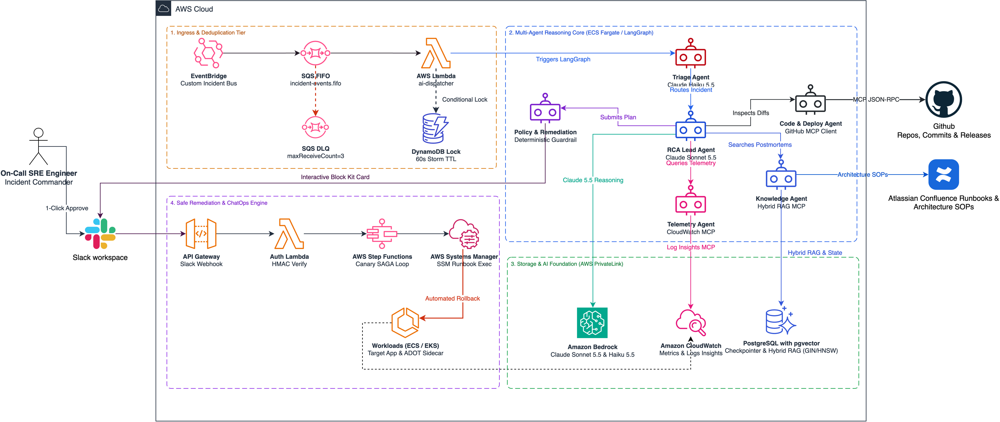
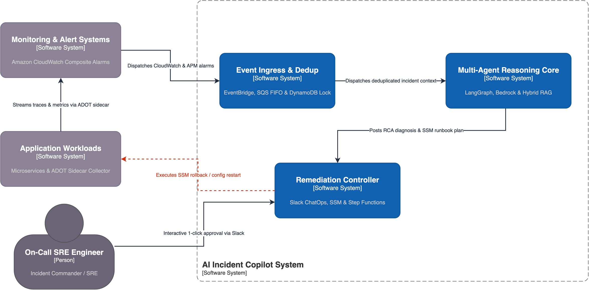
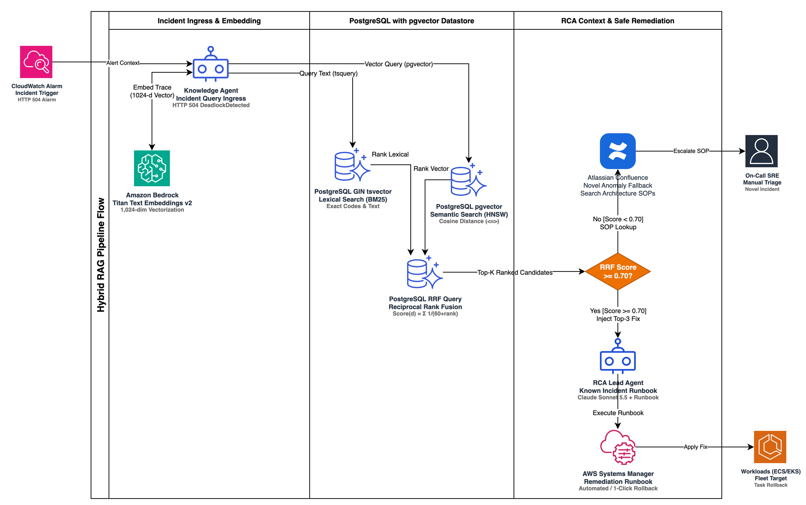
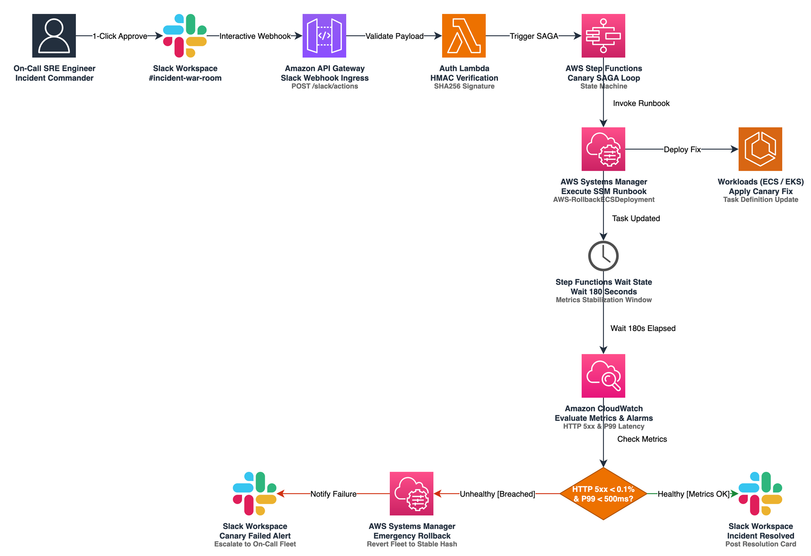

# AI Incident Copilot: Hybrid 3:00 AM Incident Support Platform

[](https://github.com/dfloresgonz/ai-incident-copilot)
[](https://builder.aws.com/content/3MW4ZwPYN9cbS66lRG6RxEmC7RE/would-you-trust-an-llm-alone-in-production-at-300-am-neither-would-i-architecting-a-hybrid-incident-copilot-with-langgraph-mcp-and-safe-chatops)
[](https://aws.amazon.com/bedrock/)
[-3357DA?style=flat-square)](https://modelcontextprotocol.io/)
[](https://github.com/pgvector/pgvector)
[](https://aws.amazon.com/systems-manager/)
[](LICENSE)

> **Would you trust an LLM alone in production at 3:00 AM? Neither would we.**
> AI Incident Copilot is not an unchecked autonomous agent running destructive mutations on live clusters. It is an **investigative SRE support platform on AWS**: multi-agent root-cause analysis (RCA) with LangGraph and Tiered Bedrock, decoupled tools via Model Context Protocol (MCP), operational memory via Hybrid RAG (BM25 + pgvector HNSW with RRF), and **safe, human-in-the-loop 1-click ChatOps** with AWS Systems Manager and Step Functions canary verification.

---

## Executive Summary: The Hybrid Support Philosophy

Would you grant an unconstrained LLM write access to your production database or Kubernetes clusters at 3:00 AM? Giving an autonomous agent free rein during a live outage is an existential risk: LLMs hallucinate under noisy telemetry, misread transient blips, and lack deterministic safety boundaries.

**However, keeping incident triage 100% manual is equally broken.**

When a major production outage strikes, monitoring systems fire cascades of simultaneous alarms. The bottleneck is almost never writing the fix—it is the **40 minutes spent correlating alerts across microservices, hunting recent git commits, and digging through outdated postmortems to remember how the bug was solved last time**.

**AI Incident Copilot** solves this by establishing a strict hybrid contract:
* **The AI accelerates investigation:** Multi-agent reasoning gathers evidence across CloudWatch metrics, logs, git deployments, and past postmortems in seconds.
* **Humans retain authoritative execution:** The copilot surfaces a synthesized diagnosis, confidence score, and pre-verified runbook in Slack. The on-call SRE approves with 1 click; AWS Systems Manager executes with scoped IAM credentials; Step Functions canary loops automatically roll back if errors persist.
* **MTTR Compression:** From **45 minutes to under 3 minutes** for recurring and correlated failure modes.
* **Alert Storm Absorption:** Amazon SQS FIFO buffers and aggregates redundant alarm bursts into a single unified incident report.
* **Dual-Memory Search:** Hybrid RAG achieves **+40% retrieval precision** over pure vector search on exact error codes (`HTTP 504`, `DeadlockDetected`).
* **Zero Destructive Autonomy:** LLMs propose; humans verify and approve; AWS Systems Manager executes; Step Functions monitors canary health.

---

## System Architecture

### 1. Detailed Component Architecture (L3 Level)

The end-to-end production architecture spans four decoupled tiers connected via **AWS PrivateLink VPC Endpoints**:



### 2. System Context (C1 Level)

How the multi-agent copilot sits within the broader engineering ecosystem:



---

## Architectural Deep Dive

### Tier 1: Ingress & Alert Storm Aggregation (ADR-02)
During cascading outages, CloudWatch Synthetics triggers hundreds of alarms within seconds. To prevent the **thundering herd problem**:
1. Amazon EventBridge captures `ALARM` state changes and enqueues them into an **Amazon SQS FIFO queue**.
2. A lightweight Lambda Dispatcher acquires a **60-second correlation lock** in Amazon DynamoDB.
3. Redundant alarms for the same service are buffered and aggregated into a single `IncidentBatch`, ensuring only one multi-agent investigation is dispatched.

### Tier 2: Multi-Agent Reasoning Core (LangGraph & Bedrock) (ADR-01)
Investigation is orchestrated as a stateful graph running on **Amazon ECS Fargate**:
* **Triage Agent (`claude-haiku-5-5`):** Classifies severity (P1–P4) in sub-800ms and filters flapping monitors.
* **Telemetry Agent:** Queries CloudWatch Metrics (P99 latency, CPU, connection pools) and Logs Insights via MCP.
* **Code Agent:** Inspects git commit diffs and deployment metadata within the failure window via GitHub MCP.
* **Memory Agent:** Searches historical postmortems in PostgreSQL via Hybrid RAG.
* **RCA Lead Agent (`claude-sonnet-5-5`):** Synthesizes evidence into a definitive root-cause hypothesis.
* **Policy Engine:** Deterministic Pydantic v2 validation ensuring proposed runbooks belong to the pre-authorized catalog.

### Tier 3: Operational Memory via Hybrid RAG & RRF (ADR-03)
Exact error codes (`HTTP 504`, `ORA-00060`) get diluted in high-dimensional vector spaces. We combine:
* **BM25 Lexical Search:** PostgreSQL GIN index on `tsvector` for exact error signatures.
* **Semantic Search:** `pgvector` HNSW index on 1,024-dimensional Titan Text Embeddings v2.
* **Reciprocal Rank Fusion (RRF):** Blends both rankings in SQL with constant $k=60$:

$$\text{RRF}(d) = \sum_{m \in \{\text{BM25}, \text{HNSW}\}} \frac{1}{60 + \text{rank}_m(d)}$$



### Tier 4: Safe ChatOps & Canary Remediation (ADR-04)
To eliminate catastrophic automation risks, execution follows a deterministic canary loop:
1. **Interactive Slack Card:** SRE receives diagnosis and clicks **"⚡ Authorize 1-Click Remediation"** (validated via HMAC SHA-256).
2. **SSM Execution:** AWS Systems Manager executes the approved runbook (`restart-service.yaml` or `rollback.yaml`).
3. **180s Canary Window:** Step Functions halts and monitors CloudWatch 5xx error rates.
4. **Automated Rollback:** If 5xx error rate remains $\ge 0.1\%$, Step Functions triggers an immediate rollback.



---

## Architecture Decision Records (ADRs)

| ADR Ref | Architectural Decision | Alternatives Considered | Trade-Off Accepted | Primary Benefit |
| :--- | :--- | :--- | :--- | :--- |
| **ADR-01** | **Multi-Agent Graph (LangGraph)** | Monolithic Agent / Mega-prompt | +800ms graph routing latency | Tool isolation & zero context pollution |
| **ADR-02** | **SQS FIFO Buffer & Aggregation** | Direct EventBridge Invocations | 30--60s aggregation buffer delay | Alert storm absorption & de-duplication |
| **ADR-03** | **Hybrid RAG (pgvector + BM25 RRF)** | Dense Vector Search Only | Dual-index storage overhead | +40% precision on exact error codes |
| **ADR-04** | **SSM Runbooks + Step Functions** | Generic bash / webhook runners | Formal SSM document authoring | Immutable CloudTrail audit + Canary verification |

---

## Repository Structure

```
ai-incident-copilot/
├── README.md                      # Architecture documentation and blueprint
├── Makefile                       # Development task automation
├── docker-compose.yml             # Local PostgreSQL 16 + pgvector container
├── requirements.txt               # Python dependencies
├── agent/                         # LangGraph Multi-Agent Core
│   ├── graph.py                   # StateGraph assembly & conditional routing
│   ├── state.py                   # IncidentState TypedDict schema
│   └── nodes/                     # Specialized reasoning agents
│       ├── triage.py              # Triage Agent (Claude Haiku 5.5)
│       ├── telemetry.py           # Observability Agent (MCP CloudWatch)
│       ├── code.py                # Code Agent (MCP GitHub)
│       ├── memory.py              # Postmortem Agent (Hybrid RAG)
│       ├── rca_lead.py            # RCA Lead (Claude Sonnet 5.5)
│       └── policy.py              # Pydantic v2 deterministic validator
├── database/                      # Hybrid RAG Storage
│   ├── schema.sql                 # PostgreSQL tables, GIN & HNSW indices
│   ├── rrf_search.sql             # Reciprocal Rank Fusion SQL function
│   └── seed_incidents.sql         # Real-world historical postmortems
├── chatops/                       # Slack Block Kit integration
│   ├── slack_card.py              # Interactive Block Kit card generator
│   └── signature.py               # Slack HMAC SHA-256 verification
├── remediation/                   # SSM Automation & Step Functions
│   ├── canary_statemachine.asl.json # Step Functions canary verification state machine
│   └── ssm_runbooks/              # Formal YAML automation documents
│       └── restart_ecs_service.yaml
├── lambdas/                       # Serverless Ingress Handlers
│   └── dispatcher/
│       └── handler.py             # SQS FIFO alert aggregator & deduplicator
├── infra/                         # Infrastructure as Code
│   ├── main.tf                    # SQS FIFO, DynamoDB, EventBridge rules
│   ├── variables.tf
│   └── outputs.tf
└── docs/                          # Architecture diagrams and assets
    └── images/
```

---

## Quickstart & Local Execution

### 1. Start Local PostgreSQL with pgvector
```bash
make up
```

### 2. Seed Historical Postmortems
```bash
make seed
```

### 3. Run Multi-Agent Triage Simulation
```bash
python -m agent.graph
```

Sample output:
```json
{
  "incident_id": "inc-live-8921",
  "service_name": "checkout-service",
  "severity": "P1",
  "root_cause_hypothesis": "Incident in checkout-service is driven by DB Connection Pool Exhaustion (100% capacity). Triggered by recent commit 7a8f3b1 executing unindexed table locks in /checkout/pay. Matches historical incident INC-2025-089.",
  "recommended_runbook": "AWS-RestartECSService",
  "is_policy_approved": true
}
```

---

## Author & Contact

**Diego Flores Gonzales**  
*Solutions Architect*  
* [LinkedIn](https://www.linkedin.com/in/diego-flores-gonzales/)  
* [AWS Builder Center Article](https://builder.aws.com/content/3MW4ZwPYN9cbS66lRG6RxEmC7RE/would-you-trust-an-llm-alone-in-production-at-300-am-neither-would-i-architecting-a-hybrid-incident-copilot-with-langgraph-mcp-and-safe-chatops)  
* [GitHub](https://github.com/dfloresgonz)
